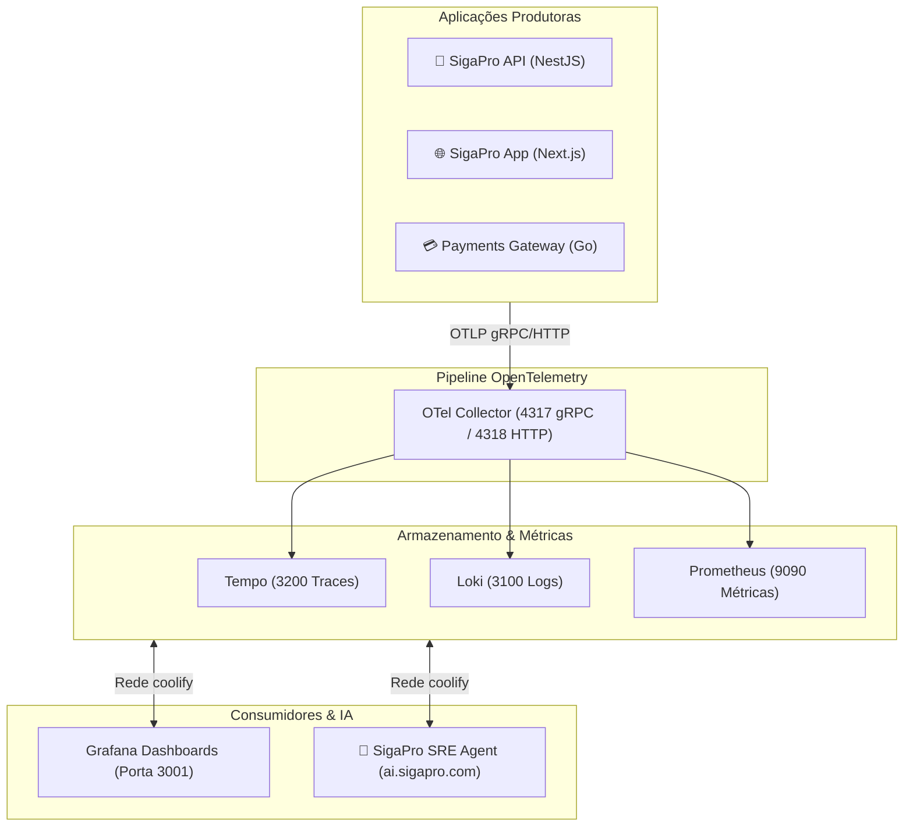

# 🔭 SigaPro Monitoring & Observability Stack

Plataforma unificada de observabilidade para o ecossistema SigaPro e Envolvati Payments Gateway. Esta stack centraliza a ingestão de **Traces Distribuídos**, **Métricas de Performance** e **Logs Estruturados**, integrando nativamente **Grafana, Prometheus, Tempo, Loki e OpenTelemetry Collector**.

---

## 🏗 Componentes da Stack

| Serviço | Imagem Docker | Porta Interna | Função Principal |
| :--- | :--- | :--- | :--- |
| **OTel Collector** | `otel/opentelemetry-collector-contrib:0.157.0` | `4317` (gRPC)<br>`4318` (HTTP) | Gateway de ingestão unificada de traces, métricas e logs dos microsserviços. |
| **Grafana Tempo** | `grafana/tempo:3.0.2` | `3200` (HTTP) | Armazenamento de alta performance para Tracing Distribuído. |
| **Grafana Loki** | `grafana/loki:3.7.4` | `3100` (HTTP) | Agregação, busca e retenção de logs estruturados e exceções. |
| **Prometheus** | `prom/prometheus:v3.13.2` | `9090` (HTTP) | Coleta e armazenamento de métricas temporais (latência p95/p99, erro 5xx). |
| **Grafana** | `grafana/grafana:13.1.1` | `3000` (mapeada para `3001` no host) | Interface visual com datasources pré-provisionados e navegação bidirecional. |

---

## 🌐 Topologia de Rede e Comunicação

Todos os serviços da stack rodam conectados à rede Docker externa **`coolify`**:



> **Consumo por IA**: As métricas, traces e logs indexados aqui são consumidos diretamente pelo **[sigapro-sre-agent](https://github.com/envolvati/sigapro-sre-agent)** para gerar diagnósticos automatizados de Root Cause Analysis (RCA) e resumos no Telegram.

---

## 🚀 Como Subir a Stack

### 1. Pré-Requisitos
Certifique-se de que a rede Docker externa existe (o Coolify cria automaticamente):
```bash
docker network create coolify || true
```

### 2. Deploy via Coolify
1. No Coolify, crie um novo recurso apontando para este repositório (`envolvati/sigapro-monitoring`).
2. Defina o tipo de build como **Docker Compose**.
3. Na configuração do serviço `grafana`, defina o domínio público (ex.: `https://monitor.sigapro.com`).
4. Execute o Deploy.

### 3. Deploy Local / Docker Compose manual
```bash
docker compose up -d
```
* **Grafana**: Acessível em `http://localhost:3001` (login padrão: `admin` / `admin`).
* **Datasources**: Já provisionados automaticamente em `grafana/provisioning/datasources/datasources.yaml`.

---

## 🔌 Guia de Instrumentação dos SDKs OpenTelemetry

Para que suas aplicações enviem telemetria automaticamente para esta stack, siga o passo a passo da sua linguagem/framework:

---

### 1. Node.js & NestJS (`sigapro-api`)

#### Instalação dos Pacotes:
```bash
pnpm add @opentelemetry/sdk-node \
  @opentelemetry/auto-instrumentations-node \
  @opentelemetry/exporter-trace-otlp-grpc \
  @opentelemetry/resources \
  @opentelemetry/semantic-conventions
```

#### Arquivo de Inicialização (`src/tracing.ts`):
> **Importante**: Este arquivo DEVE ser executado antes de qualquer outro import da aplicação.

```typescript
import { NodeSDK } from '@opentelemetry/sdk-node'
import { getNodeAutoInstrumentations } from '@opentelemetry/auto-instrumentations-node'
import { OTLPTraceExporter } from '@opentelemetry/exporter-trace-otlp-grpc'
import { Resource } from '@opentelemetry/resources'
import { SemanticResourceAttributes } from '@opentelemetry/semantic-conventions'

const traceExporter = new OTLPTraceExporter({
  url: process.env.OTEL_EXPORTER_OTLP_ENDPOINT || 'http://otel-collector:4317',
})

export const otelSDK = new NodeSDK({
  resource: new Resource({
    [SemanticResourceAttributes.SERVICE_NAME]: process.env.OTEL_SERVICE_NAME || 'sigapro-api',
    [SemanticResourceAttributes.DEPLOYMENT_ENVIRONMENT]: process.env.ENV || 'production',
  }),
  traceExporter,
  instrumentations: [
    getNodeAutoInstrumentations({
      '@opentelemetry/instrumentation-fs': { enabled: false }, // Desativa logs ruidosos de filesystem
    }),
  ],
})

otelSDK.start()

process.on('SIGTERM', () => {
  otelSDK.shutdown().finally(() => process.exit(0))
})
```

#### No `src/main.ts`:
```typescript
import './tracing' // Primeira linha do arquivo!
import { NestFactory } from '@nestjs/core'
import { AppModule } from './app.module'

async function bootstrap() {
  const app = await NestFactory.create(AppModule)
  await app.listen(process.env.PORT || 8000)
}
bootstrap()
```

#### Variáveis de Ambiente no `.env`:
```env
OTEL_SERVICE_NAME=sigapro-api-prod
OTEL_EXPORTER_OTLP_ENDPOINT=http://otel-collector:4317
ENV=production
```

---

### 2. Next.js App Router (`sigapro-app` / Frontend)

O Next.js possui suporte nativo a instrumentação de servidor através do hook `instrumentation.ts`.

#### Instalação dos Pacotes:
```bash
pnpm add @opentelemetry/sdk-node \
  @opentelemetry/resources \
  @opentelemetry/semantic-conventions \
  @opentelemetry/exporter-trace-otlp-http
```

#### No `next.config.js` (ou `.mjs`):
```javascript
/** @type {import('next').NextConfig} */
const nextConfig = {
  experimental: {
    instrumentationHook: true,
  },
}
module.exports = nextConfig
```

#### Arquivo `src/instrumentation.ts`:
```typescript
export async function register() {
  if (process.env.NEXT_RUNTIME === 'nodejs') {
    const { NodeSDK } = await import('@opentelemetry/sdk-node')
    const { OTLPTraceExporter } = await import('@opentelemetry/exporter-trace-otlp-http')
    const { Resource } = await import('@opentelemetry/resources')
    const { SemanticResourceAttributes } = await import('@opentelemetry/semantic-conventions')

    const sdk = new NodeSDK({
      resource: new Resource({
        [SemanticResourceAttributes.SERVICE_NAME]: 'sigapro-app-frontend',
      }),
      traceExporter: new OTLPTraceExporter({
        url: process.env.OTEL_EXPORTER_OTLP_ENDPOINT || 'http://otel-collector:4318/v1/traces',
      }),
    })
    sdk.start()
  }
}
```

---

### 3. Golang (`envolvati-payments-gateway`)

#### Instalação dos Módulos:
```bash
go get go.opentelemetry.io/otel \
  go.opentelemetry.io/otel/sdk \
  go.opentelemetry.io/otel/exporters/otlp/otlptrace/otlptracegrpc \
  go.opentelemetry.io/contrib/instrumentation/net/http/otelhttp
```

#### Inicializador do Tracer Provider (`internal/shared/telemetry/tracer.go`):
```go
package telemetry

import (
	"context"
	"os"

	"go.opentelemetry.io/otel"
	"go.opentelemetry.io/otel/exporters/otlp/otlptrace/otlptracegrpc"
	"go.opentelemetry.io/otel/propagation"
	"go.opentelemetry.io/otel/sdk/resource"
	sdktrace "go.opentelemetry.io/otel/sdk/trace"
	semconv "go.opentelemetry.io/otel/semconv/v1.26.0"
)

func InitTracer(ctx context.Context) (*sdktrace.TracerProvider, error) {
	endpoint := os.Getenv("OTEL_EXPORTER_OTLP_ENDPOINT")
	if endpoint == "" {
		endpoint = "otel-collector:4317"
	}

	exporter, err := otlptracegrpc.New(ctx,
		otlptracegrpc.WithInsecure(),
		otlptracegrpc.WithEndpoint(endpoint),
	)
	if err != nil {
		return nil, err
	}

	res, err := resource.New(ctx,
		resource.WithAttributes(
			semconv.ServiceNameKey.String("envolvati-payments-gateway"),
			semconv.DeploymentEnvironmentKey.String(os.Getenv("ENVIRONMENT")),
		),
	)
	if err != nil {
		return nil, err
	}

	tp := sdktrace.NewTracerProvider(
		sdktrace.WithBatcher(exporter),
		sdktrace.WithResource(res),
	)

	otel.SetTracerProvider(tp)
	otel.SetTextMapPropagator(propagation.NewCompositeTextMapPropagator(
		propagation.TraceContext{},
		propagation.Baggage{},
	))

	return tp, nil
}
```

#### Rastreando Rotas HTTP (`cmd/api/main.go`):
```go
tp, err := telemetry.InitTracer(ctx)
if err != nil {
    log.Fatalf("Falha ao inicializar tracer: %v", err)
}
defer tp.Shutdown(ctx)

// Envolve seu mux HTTP com o middleware automático do OpenTelemetry
handler := otelhttp.NewHandler(rootMux, "payments-gateway-router")
http.ListenAndServe(":8080", handler)
```

---

## 🎯 Correlação Traces ↔ Logs no Grafana (A Mágica)

Os datasources desta stack já vêm com links derivados configurados:

1. **Do Trace para os Logs**: Ao inspecionar um Span lento ou com erro no Tempo, o botão **"Logs for this span"** abre instantaneamente as linhas de log correspondentes no Loki.
2. **Do Log para o Trace**: Qualquer log no Loki que contenha `"traceid":"..."` ganha um link clicável direto para abrir a visualização em cascata do Tempo.
